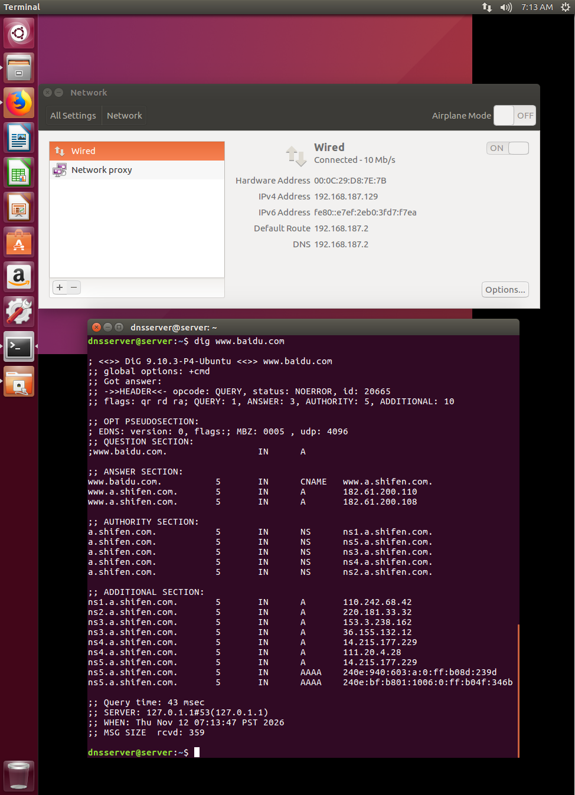

## HOST配置


## dig 工具

### dig 解析

一开始IPv4网络提前配置到了后续要求的网络（IPv4 地址192.168.187.130 子网掩码255.255.255.0），结果失败。

```
dnsserver@server:~$ dig www.baidu.com

; <<>> DiG 9.10.3-P4-Ubuntu <<>> www.baidu.com
;; global options: +cmd
;; Got answer:
;; ->>HEADER<<- opcode: QUERY, status: SERVFAIL, id: 39821
;; flags: qr rd ra; QUERY: 1, ANSWER: 0, AUTHORITY: 0, ADDITIONAL: 1

;; OPT PSEUDOSECTION:
; EDNS: version: 0, flags:; udp: 4096
;; QUESTION SECTION:
;www.baidu.com.			IN	A

;; Query time: 880 msec
;; SERVER: 127.0.1.1#53(127.0.1.1)
;; WHEN: Thu Nov 12 07:04:55 PST 2026
;; MSG SIZE  rcvd: 42
```

设置为IPv4直连后反而是正常的。



### root 根服务器

`+trace` 可查看逐级解析，追踪从 DNS 根开始的逐级查询。
$$

\text{根域名服务器}\\\implies

\text{.com 顶级域服务器}\\\implies

\text{bilibili.com 权威服务器}\\\implies

\text{得到最终解析结果}
$$

```
dnsserver@server:~$ dig +trace www.bilibili.com

; <<>> DiG 9.10.3-P4-Ubuntu <<>> +trace www.bilibili.com
;; global options: +cmd
.			5	IN	NS	e.root-servers.net.
.			5	IN	NS	a.root-servers.net.
.			5	IN	NS	b.root-servers.net.
.			5	IN	NS	f.root-servers.net.
.			5	IN	NS	i.root-servers.net.
.			5	IN	NS	h.root-servers.net.
.			5	IN	NS	m.root-servers.net.
.			5	IN	NS	c.root-servers.net.
.			5	IN	NS	j.root-servers.net.
.			5	IN	NS	g.root-servers.net.
.			5	IN	NS	d.root-servers.net.
.			5	IN	NS	l.root-servers.net.
.			5	IN	NS	k.root-servers.net.
.			5	IN	RRSIG	NS 8 0 518400 20261124200000 20261111190000 8763 . cjQwebQ8nHIc6NzUhyR5ln5dtivAcCu4z257Jb7Z/JS8zwIsjMcTnc4c Is+E4ce7akuVYaEgxS2Zy8e8RnGgM0f+TmBNcClSRj7xiAtjOoWyANZW h+nCEvVS1h3ph1UeuCGB0B9kfkOp3v3RHCGaK3nb3PN+rV2916/VvSZe iVSEDNMkK2Y13fPIB1z9wRWf4kf8xHrRXle3QqrUYgl1Jj7bCGMeeCRT 6am+hURZKj6g7SI1bxyXONEKGFLgyzigj2VRO5jNKVgb4rOvF0aKqjzd 8unIdPw45ZKNH6IMwXmusTPLl1EulOf6wtJIKvd69gSMEdWKg8Ns0au+ YOcoQg==
;; Received 1097 bytes from 127.0.1.1#53(127.0.1.1) in 18 ms

com.			172800	IN	NS	i.gtld-servers.net.
com.			172800	IN	NS	a.gtld-servers.net.
com.			172800	IN	NS	g.gtld-servers.net.
com.			172800	IN	NS	j.gtld-servers.net.
com.			172800	IN	NS	h.gtld-servers.net.
com.			172800	IN	NS	l.gtld-servers.net.
com.			172800	IN	NS	f.gtld-servers.net.
com.			172800	IN	NS	b.gtld-servers.net.
com.			172800	IN	NS	c.gtld-servers.net.
com.			172800	IN	NS	e.gtld-servers.net.
com.			172800	IN	NS	m.gtld-servers.net.
com.			172800	IN	NS	d.gtld-servers.net.
com.			172800	IN	NS	k.gtld-servers.net.
com.			86400	IN	DS	19718 13 2 8ACBB0CD28F41250A80A491389424D341522D946B0DA0C0291F2D3D7 71D7805A
com.			86400	IN	RRSIG	DS 8 1 86400 20261125050000 20261112040000 8763 . Y21HuPWT7W0hRN+xU4WZgDWjNBfV/kCdfnMZWZ/JXrM5DgdmkR+x9w6S wOGWp2LUOtoWeNO5m0+2IUdAow1I+EyWXyJczWmLw80jDm+9GqWeHXmQ UK3S/hEZUFI+9AEnm8OYuW0PtxIE2TJ1i06QWAYaRSPliwzUe/oeBH9N e3sgZCs/k7gZnnw9p48Uq8WYZEvwkKsLUexBHSLJoONrlAVpVTYCioTG 4YDv2VL9/4PZRQAJW7RJOadnO1CLeYPCQjrwfWQM37GF6uzJkcMUSb2z 854XhlfgVC3erBhoffCKVP+PwPRYduzBUhklMcucWF1vWvz+v5b+u+W3 UPg5Vw==
;; Received 1176 bytes from 202.12.27.33#53(m.root-servers.net) in 8 ms

bilibili.com.		172800	IN	NS	ns3.dnsv5.com.
bilibili.com.		172800	IN	NS	ns4.dnsv5.com.
CK0POJMG874LJREF7EFN8430QVIT8BSM.com. 900 IN NSEC3 1 1 0 - CK0Q35HRS4H76G6CHNB9414CJN6S5UPL NS SOA RRSIG DNSKEY NSEC3PARAM
CK0POJMG874LJREF7EFN8430QVIT8BSM.com. 900 IN RRSIG NSEC3 13 2 900 20261118002605 20261110231605 65344 com. ZlJH4zBTd8732a1sdMrM1t1uuJ5HV9bhZ2nkKH/fObF0lZ4F2Xq3/iVy jLN99usMe6ipC1s+h7vgkJN6UzsdYA==
34N8IUNMFDGUL13GCNB325CKVM924592.com. 900 IN NSEC3 1 1 0 - 34N8VOVER4CALDU6ILDJ57NE037S5FB1 NS DS RRSIG
34N8IUNMFDGUL13GCNB325CKVM924592.com. 900 IN RRSIG NSEC3 13 2 900 20261119031402 20261112020402 65344 com. ERSfmtMMGCl+c+k7FmsQ5qxcWE24RCXaebATyIQejXnDwUIK2pEklYT4 CYThe291Hd83m2K8ELutHfDmDwGiVQ==
;; Received 772 bytes from 192.31.80.30#53(d.gtld-servers.net) in 189 ms

www.bilibili.com.	300	IN	CNAME	a.w.bilicdn1.com.
;; Received 75 bytes from 101.227.168.52#53(ns3.dnsv5.com) in 68 ms
```

### .com 服务器

`NS` 是 域名服务器记录。

```
dnsserver@server:~$ dig NS com

; <<>> DiG 9.10.3-P4-Ubuntu <<>> NS com
;; global options: +cmd
;; Got answer:
;; ->>HEADER<<- opcode: QUERY, status: NOERROR, id: 32211
;; flags: qr rd ra; QUERY: 1, ANSWER: 13, AUTHORITY: 0, ADDITIONAL: 12

;; QUESTION SECTION:
;com.				IN	NS

;; ANSWER SECTION:
com.			5	IN	NS	i.gtld-servers.net.
com.			5	IN	NS	m.gtld-servers.net.
com.			5	IN	NS	h.gtld-servers.net.
com.			5	IN	NS	j.gtld-servers.net.
com.			5	IN	NS	g.gtld-servers.net.
com.			5	IN	NS	b.gtld-servers.net.
com.			5	IN	NS	l.gtld-servers.net.
com.			5	IN	NS	e.gtld-servers.net.
com.			5	IN	NS	c.gtld-servers.net.
com.			5	IN	NS	k.gtld-servers.net.
com.			5	IN	NS	d.gtld-servers.net.
com.			5	IN	NS	f.gtld-servers.net.
com.			5	IN	NS	a.gtld-servers.net.

;; ADDITIONAL SECTION:
a.gtld-servers.net.	5	IN	A	192.5.6.30
a.gtld-servers.net.	5	IN	AAAA	2001:503:a83e::2:30
b.gtld-servers.net.	5	IN	A	192.33.14.30
b.gtld-servers.net.	5	IN	AAAA	2001:503:231d::2:30
c.gtld-servers.net.	5	IN	A	192.26.92.30
c.gtld-servers.net.	5	IN	AAAA	2001:503:83eb::30
d.gtld-servers.net.	5	IN	A	192.31.80.30
d.gtld-servers.net.	5	IN	AAAA	2001:500:856e::30
e.gtld-servers.net.	5	IN	A	192.12.94.30
e.gtld-servers.net.	5	IN	AAAA	2001:502:1ca1::30
f.gtld-servers.net.	5	IN	A	192.35.51.30
f.gtld-servers.net.	5	IN	AAAA	2001:503:d414::30

;; Query time: 58 msec
;; SERVER: 127.0.1.1#53(127.0.1.1)
;; WHEN: Thu Nov 12 07:19:10 PST 2026
;; MSG SIZE  rcvd: 509
```

### bilibili.com 服务器

查询对应域名的 NS 记录。

```
dnsserver@server:~$ dig NS bilibili.com

; <<>> DiG 9.10.3-P4-Ubuntu <<>> NS bilibili.com
;; global options: +cmd
;; Got answer:
;; ->>HEADER<<- opcode: QUERY, status: NOERROR, id: 10573
;; flags: qr rd ra; QUERY: 1, ANSWER: 2, AUTHORITY: 0, ADDITIONAL: 16

;; OPT PSEUDOSECTION:
; EDNS: version: 0, flags:; MBZ: 0005 , udp: 4096
;; QUESTION SECTION:
;bilibili.com.			IN	NS

;; ANSWER SECTION:
bilibili.com.		5	IN	NS	ns4.dnsv5.com.
bilibili.com.		5	IN	NS	ns3.dnsv5.com.

;; ADDITIONAL SECTION:
ns3.dnsv5.com.		5	IN	A	220.196.136.52
ns3.dnsv5.com.		5	IN	A	1.12.0.17
ns3.dnsv5.com.		5	IN	A	1.12.0.18
ns3.dnsv5.com.		5	IN	A	1.14.119.52
ns3.dnsv5.com.		5	IN	A	36.155.149.52
ns3.dnsv5.com.		5	IN	A	43.140.237.52
ns3.dnsv5.com.		5	IN	A	101.227.168.52
ns3.dnsv5.com.		5	IN	AAAA	2402:4e00:1730::f
ns4.dnsv5.com.		5	IN	A	43.140.78.52
ns4.dnsv5.com.		5	IN	A	49.7.107.152
ns4.dnsv5.com.		5	IN	A	117.135.128.152
ns4.dnsv5.com.		5	IN	A	1.12.0.16
ns4.dnsv5.com.		5	IN	A	1.12.0.19
ns4.dnsv5.com.		5	IN	A	1.14.119.54
ns4.dnsv5.com.		5	IN	AAAA	2402:4e00:1231::8

;; Query time: 10 msec
;; SERVER: 127.0.1.1#53(127.0.1.1)
;; WHEN: Thu Nov 12 07:19:10 PST 2026
;; MSG SIZE  rcvd: 347
```

### 服务器地址

`A` 是 IPv4 地址记录。查询B站服务器地址。

```
dnsserver@server:~$ dig www.bilibili.com

; <<>> DiG 9.10.3-P4-Ubuntu <<>> www.bilibili.com
;; global options: +cmd
;; Got answer:
;; ->>HEADER<<- opcode: QUERY, status: NOERROR, id: 42970
;; flags: qr rd ra; QUERY: 1, ANSWER: 5, AUTHORITY: 2, ADDITIONAL: 16

;; OPT PSEUDOSECTION:
; EDNS: version: 0, flags:; MBZ: 0005 , udp: 4096
;; QUESTION SECTION:
;www.bilibili.com.		IN	A

;; ANSWER SECTION:
www.bilibili.com.	5	IN	CNAME	a.w.bilicdn1.com.
a.w.bilicdn1.com.	5	IN	A	121.194.11.75
a.w.bilicdn1.com.	5	IN	A	121.194.11.73
a.w.bilicdn1.com.	5	IN	A	121.194.11.74
a.w.bilicdn1.com.	5	IN	A	121.194.11.72

;; AUTHORITY SECTION:
bilicdn1.com.		5	IN	NS	ns3.dnsv5.com.
bilicdn1.com.		5	IN	NS	ns4.dnsv5.com.

;; ADDITIONAL SECTION:
ns3.dnsv5.com.		5	IN	A	1.12.0.18
ns3.dnsv5.com.		5	IN	A	1.14.119.52
ns3.dnsv5.com.		5	IN	A	36.155.149.52
ns3.dnsv5.com.		5	IN	A	43.140.237.52
ns3.dnsv5.com.		5	IN	A	101.227.168.52
ns3.dnsv5.com.		5	IN	A	220.196.136.52
ns3.dnsv5.com.		5	IN	A	1.12.0.17
ns3.dnsv5.com.		5	IN	AAAA	2402:4e00:1730::f
ns4.dnsv5.com.		5	IN	A	1.14.119.54
ns4.dnsv5.com.		5	IN	A	43.140.78.52
ns4.dnsv5.com.		5	IN	A	49.7.107.152
ns4.dnsv5.com.		5	IN	A	117.135.128.152
ns4.dnsv5.com.		5	IN	A	1.12.0.16
ns4.dnsv5.com.		5	IN	A	1.12.0.19
ns4.dnsv5.com.		5	IN	AAAA	2402:4e00:1231::8

;; Query time: 38 msec
;; SERVER: 127.0.1.1#53(127.0.1.1)
;; WHEN: Thu Nov 12 07:19:12 PST 2026
;; MSG SIZE  rcvd: 442

```

## DNS投毒实验

### 启动BIND9

